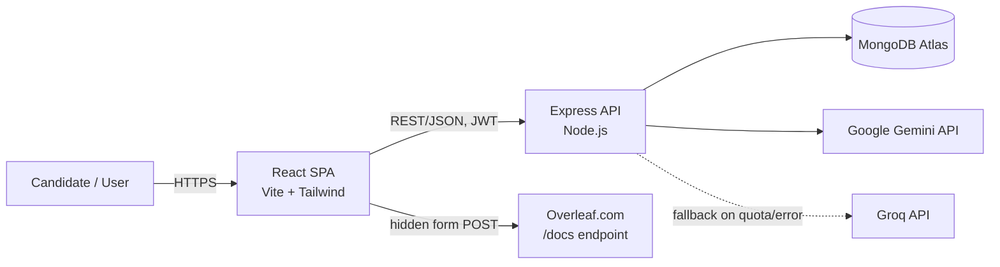
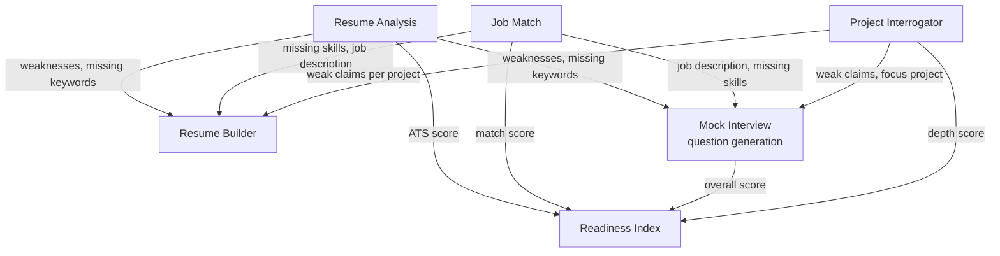

# High-Level Design (HLD)

**Product:** Placement & Career Preparation Platform (evolved from "Resume Optimizer")
**Stack:** MERN (MongoDB, Express, React, Node.js) + Google Gemini / Groq LLMs
**Audience:** Engineering team, future contributors, technical reviewers

---

## 1. Purpose

A web platform that takes a candidate from "I have a resume" to "I am ready to interview for a specific job," using AI where judgment is genuinely needed and deterministic logic everywhere else. It is not a single tool — it is eight interconnected features that share data with each other so that a weakness found in one feature is surfaced and actioned in the others.

## 2. System Context

- The frontend never talks to Gemini/Groq/MongoDB directly — all AI and data access goes through the Express API.
- The one exception is **Overleaf export**: the browser submits a hidden form directly to `overleaf.com/docs` with a `snip` field containing generated LaTeX. No backend involvement, no file hosting.

## 3. Architecture Style

- **Client-server, REST over JSON.** Stateless API; auth via JWT bearer token (no server-side sessions).
- **Monolithic Express backend**, organized by feature (route → controller → shared service layer), not microservices — appropriate at this scale (single-user-oriented tool, not a multi-tenant SaaS).
- **Single shared AI service layer** (`backend/services/geminiService.js`) that every feature-controller calls into, rather than each controller talking to the LLM provider directly. This is the seam where retries, structured-output enforcement, and provider fallback live, so every feature gets those guarantees for free.

## 4. Major Subsystems

| # | Subsystem | What it does | AI or deterministic? |
|---|-----------|---------------|----------------------|
| 1 | **Auth** | Signup/login, JWT issuance, route protection | Deterministic |
| 2 | **Resume Management** | Upload PDF, extract text (`pdf-parse`), list/delete resumes | Deterministic |
| 3 | **Resume Analysis** | Judges resume quality against a 5-part rubric; separately, a rule-based **Parseability Checker** flags real ATS-parsing risk (multi-column signatures, encoding artifacts, missing sections) | Hybrid — AI for judgment, rules for structural risk |
| 4 | **Job Match** | Compares a resume against a specific job description (pasted or PDF-uploaded); produces matched/missing skills and a fit score | AI |
| 5 | **Project Interrogator** | Multi-turn AI "panelist" cross-examines a project on the resume, calibrated for a college-fresher candidate, to catch claims the candidate can't actually defend (the "vibe-coded project" problem) | AI (conversational) |
| 6 | **Resume Builder** | Structured editor for resume content; preserves the original's section order, skill categories, project links, and experience locations; surfaces recommendations pulled from Analysis, Job Match, and Project Interrogator; exports to **Overleaf** as one of three real LaTeX templates | Hybrid — AI for parsing/improving text, deterministic for LaTeX generation and template recommendation |
| 7 | **Mock Interview Simulator** | Generates interview questions (HR/Technical/Behavioral) biased toward the candidate's already-known weak areas across the platform; scores answers; supports voice input | AI |
| 8 | **Placement Readiness Index** | A single composite score aggregating Analysis, Job Match, Mock Interview, and Project Defense performance, with a percentile rank and an AI-written narrative insight | Hybrid — aggregation math is deterministic, the narrative is AI |

## 5. Technology Stack

| Layer | Choice | Notes |
|---|---|---|
| Frontend framework | React 19 + Vite | Fast dev server, ESM-native build |
| Styling | Tailwind CSS v4 (`@theme` tokens) | Custom "Ledger" palette (graphite/steel-teal/bronze), Newsreader (headings) + Inter (body) |
| Icons | `lucide-react` | Replaced emoji-as-icons across the app |
| Routing | `react-router-dom` v7 | Client-side SPA routing, `ProtectedRoute` gate |
| HTTP client | `axios` | Shared instance in `services/api.js` with JWT auto-attach |
| Backend framework | Express 5 on Node.js | REST API, `helmet`/`cors`/`morgan` middleware |
| Database | MongoDB Atlas + Mongoose 9 | Non-SRV connection string (see Setup doc — SRV DNS records are blocked on some networks) |
| Auth | `jsonwebtoken` + `bcryptjs` | 7-day JWT, bearer header |
| File upload | `multer` (disk storage) | Resumes, job description PDFs, certification images/PDFs — all deleted from disk after processing |
| PDF text extraction | `pdf-parse` | Used for resumes and job-description PDFs |
| Primary LLM | Google Gemini (`@google/genai`) | Model configurable via `MODEL` constant in `geminiService.js` |
| Fallback LLM | Groq (OpenAI-compatible REST) | Kicks in automatically when Gemini errors for any reason |
| Resume export | Client-generated LaTeX → Overleaf | No LaTeX compiler in this stack; Overleaf compiles server-side on their end |

## 6. Cross-Feature Data Flow (the "interconnection" layer)

This is the part that turns eight separate tools into one platform. Concretely:

Every arrow above is a real, implemented data dependency (not aspirational) — e.g. Mock Interview's `startInterview` controller queries the latest Analysis, Job Match, and Project Interrogator records for the selected resume before generating questions, and biases at least half the question set toward those known gaps.

## 7. Security Model

- All feature endpoints require a valid JWT (`Authorization: Bearer <token>`), verified by `middleware/auth.js`.
- Every document read/write is scoped with `{ _id, user: req.user.id }` — there is no endpoint that returns or mutates another user's data by guessable ID.
- Secrets (`GEMINI_API_KEY`, `GROQ_API_KEY`, `MONGODB_URI`, `JWT_SECRET`) live only in `.env`, gitignored, never logged.
- Uploaded files are validated by MIME type (PDF-only for resumes/JDs; PDF+image for certifications), size-capped (5MB), and deleted from disk immediately after text/data extraction — nothing is retained on disk beyond the request lifecycle.

## 8. AI Reliability Strategy

Free-tier LLM quotas are the platform's single biggest operational risk (as low as 20 requests/day per Gemini model on the account used in development). The mitigations, in order of what actually shipped:

1. **Retry with exponential backoff** on transient errors (429/500/502/503/504).
2. **Provider fallback**: if Gemini fails for any reason after retries, the same request is automatically retried against Groq (a separate free-tier provider, own quota, own terms) before surfacing an error to the user.
3. **Deterministic-first design**: anything that doesn't require judgment (parseability scoring, ATS-score arithmetic, template recommendation, LaTeX generation, readiness aggregation) is pure code, not an LLM call — zero quota cost, always available even when both providers are exhausted.
4. **Caching / call-avoidance**: re-parsing a resume or re-extracting its projects is skipped if already cached on the document, unless the user explicitly forces a re-parse.

## 9. Known Limitations

- No automated test suite (`npm test` is a placeholder). Verification throughout development relied on `eslint`, `vite build`, `node --check`, and targeted throwaway scripts exercising real logic — not CI-enforced tests.
- Overleaf compilation was never verified against a real LaTeX compiler in the development environment (none available); correctness was verified structurally (brace balancing, escaping rules) and left for live user verification.
- The Readiness Index's percentile ranking is only meaningful once there's a real population of users on the platform — at low user counts it's statistically noisy.
- Single Gemini API key per deployment; no automated key rotation (deliberately not built — see project history for why).
