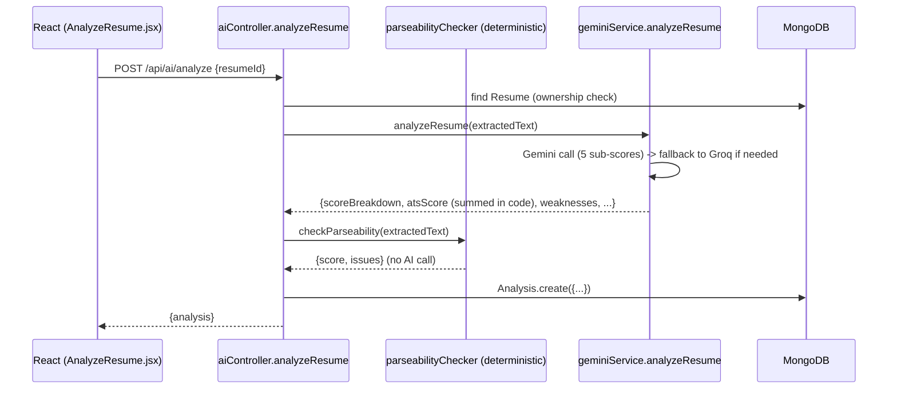
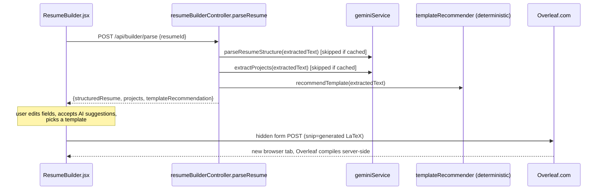
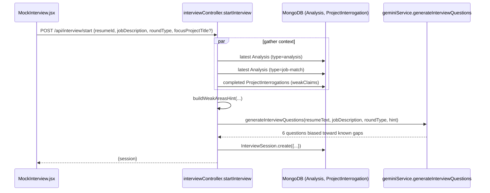

# Low-Level Design (LLD)

Companion to `HLD.md`. This document covers database schemas, module boundaries, key algorithms, and sequence flows in implementation-level detail.

---

## 1. Database Schema (MongoDB / Mongoose)

### 1.1 `User`
| Field | Type | Notes |
|---|---|---|
| `name` | String, required | |
| `email` | String, required, unique, lowercase | Login identifier |
| `password` | String, required, min 6 | bcrypt hash, never returned by any endpoint |
| `timestamps` | — | `createdAt`/`updatedAt` |

### 1.2 `Resume`
| Field | Type | Notes |
|---|---|---|
| `user` | ObjectId → User, required | Ownership |
| `originalName`, `fileName`, `filePath` | String | Original upload metadata; `filePath` points into `uploads/` |
| `extractedText` | String | Raw `pdf-parse` output — the source of truth every AI feature reads from |
| `parsedProjects` | `[{ title, link, description, techStack: [String] }]` | Shared between Resume Builder and Project Interrogator |
| `structuredResume.contactInfo` | `{ name, email, phone, location, linkedin, github }` | |
| `structuredResume.summary` | String | |
| `structuredResume.experience` | `[{ company, position, location, duration, bullets: [String] }]` | |
| `structuredResume.education` | `[{ school, degree, field, year }]` | |
| `structuredResume.skills` | **Mixed** (not a strict array type) | Intentionally loose — see §3.1 |
| `structuredResume.certifications` | `[String]` | |
| `structuredResume.sectionOrder` | `[String]`, default `[summary, experience, projects, education, skills, certifications]` | Preserves the original resume's section order through the builder |
| `structuredResume.template` | enum `[jakes, awesomecv, moderncv]`, default `jakes` | Which LaTeX template the Overleaf export uses |

### 1.3 `Analysis`
Used for both **Resume Analysis** and **Job Match** results (`type` discriminates).

| Field | Type | Notes |
|---|---|---|
| `user`, `resumeId` | ObjectId refs, required | |
| `type` | enum `[analysis, job-match]` | |
| `atsScore` | Number, required | For `analysis`: sum of `scoreBreakdown` (computed server-side, not trusted to the LLM). For `job-match`: `matchPercentage`. |
| `scoreBreakdown` | Object | `{ keywordRelevance, quantifiedImpact, formattingConsistency, sectionCompleteness, clarity }` — 0-20 each, `analysis` type only |
| `parseability` | Object | `{ score, issues: [{ type, severity, message }] }` — deterministic, `analysis` type only |
| `strengths`, `weaknesses`, `improvements` | Array | Shape varies by type (see API.md) |
| `jobDescription` | String | `job-match` type only — this is what gets reused by Mock Interview's "JD carry-forward" |
| `rawAnalysis` | Object, required | Full LLM response, superset of the above — frontend reads from here when a field isn't promoted to a top-level column |

Indexes: `{user, createdAt: -1}`, `{resumeId}`.

### 1.4 `ProjectInterrogation`
| Field | Type | Notes |
|---|---|---|
| `user`, `resumeId` | ObjectId refs, required | |
| `projectTitle` | String, required | |
| `projectSnapshot` | `{ title, description, techStack }` | Frozen at interrogation start so later resume edits don't retroactively change what was cross-examined |
| `conversation` | `[{ role: user\|model, text, hidden }]` | `hidden: true` marks the synthetic kickoff turn (not something the candidate said) |
| `status` | enum `[active, completed]` | |
| `depthScore` | Number | 0-100, set on `finish` |
| `weakClaims`, `strongMoments` | `[String]` | Set on `finish` |
| `summary` | String | Set on `finish` |

Index: `{user, createdAt: -1}`.

### 1.5 `InterviewSession`
| Field | Type | Notes |
|---|---|---|
| `user`, `resumeId` | ObjectId refs, required | |
| `jobDescription` | String, default `""` | Optional — reused from the latest Job Match if present |
| `roundType` | enum `[HR, Technical, Behavioral]`, required | |
| `questions` | `[{ question, category, targetSkill, answer, score, strengths, gaps, idealAnswerHint }]` | Populated question-by-question via `submitAnswer` |
| `status` | enum `[active, completed]` | |
| `overallScore`, `weakestArea`, `summary` | — | Set on `finish` |

Index: `{user, createdAt: -1}`.

---

## 2. Backend Module Map

```
backend/
  server.js                  — Express app wiring, route mounting
  config/
    db.js                    — Mongoose connection
    gemini.js                — GoogleGenAI client instance
    groq.js                  — Groq config (baseURL, model, key)
  middleware/
    auth.js                  — JWT verification, attaches req.user
    upload.js                — multer config: resumes + JD PDFs (PDF-only, 5MB)
    uploadCertification.js   — multer config: certifications (PDF+image, 5MB)
  models/                    — Mongoose schemas (see §1)
  services/
    geminiService.js         — single shared AI layer (see §4)
  utils/
    parseabilityChecker.js   — deterministic ATS-risk heuristic
    templateRecommender.js   — deterministic template-match heuristic
  controllers/                routes/
    authController.js          authRoutes.js
    resumeController.js        resumeRoutes.js
    aiController.js            aiRoutes.js
    jobController.js           jobRoutes.js
    analysisController.js      analysisRoutes.js
    projectController.js       projectRoutes.js
    resumeBuilderController.js resumeBuilderRoutes.js
    interviewController.js     interviewRoutes.js
    readinessController.js     readinessRoutes.js
```

## 3. Key Algorithms

### 3.1 Skills shape migration (`normalizeSkillGroups`)
`structuredResume.skills` moved from a flat `[String]` to `[{category, items}]` (to preserve grouping like "Languages / Frameworks / Tools" from the original resume). Because Mongoose's `Mixed` type applies no casting, both old and new shapes can exist in the database simultaneously. `normalizeSkillGroups` (in `frontend/src/utils/latexResume.js`, also mirrored conceptually wherever skills are read) detects the shape at read time:
```js
if (typeof skills[0] === "string") return [{ category: "", items: skills }];
// else assume already [{category, items}]
```
This is applied once, at load time in the Builder, so the rest of the UI only ever deals with one shape.

### 3.2 Template enum migration (`normalizeTemplate`)
`structuredResume.template`'s valid values changed twice during development (`modern/classic/minimal` → `classic/modern/compact` → `jakes/awesomecv/moderncv`). Mongoose validates the **entire document** on every `.save()`, not just modified paths — so a resume saved under an old enum value would fail to save at all, even on an unrelated field edit, once the enum tightened. `resumeBuilderController.js` normalizes any unrecognized template value back to `"jakes"` before every save, rather than trying to enumerate every legacy string that ever existed.

### 3.3 Parseability heuristic (`parseabilityChecker.js`)
Pure regex/heuristic scoring, zero AI cost, always available:
- **Near-empty text** (< 200 chars) → likely a scanned image with no selectable text.
- **Column-gap signature**: >15% of lines contain a run of 4+ spaces mid-line — the signature of two side-by-side text blocks merging onto one extracted line (real two-column-layout ATS failure mode, confirmed against an actual regression in this project's history — see CHANGELOG).
- **Fragmented lines**: >45% of lines under 15 characters — secondary signal for column/table layouts.
- **Encoding artifacts**: presence of the Unicode replacement character (`�`) — signature of a font-encoding bug (e.g. missing `fontenc=T1` in a LaTeX-compiled PDF, which silently corrupts ligatures like "fi"/"fl").
- **Missing standard sections**: no recognizable Experience/Education/Skills heading.
- **No email / no phone detected**: regex scan for contact patterns.

Each triggered issue subtracts fixed points from a 100-point starting score.

### 3.4 Template recommender (`templateRecommender.js`)
Same input class as §3.3, different question ("which template matches the original's structure"), and deliberately **only** uses the column-gap signal (not the short-line-ratio signal) — testing during development showed short-line-ratio false-positives on normal, sparse single-column resumes (see CHANGELOG for the real bug this caught). Decision tree:
1. Column-gap signature detected → recommend **Jake's Resume** (safest, plainest — avoid replicating multi-column risk).
2. >55 non-empty lines (dense/long resume) → recommend **ModernCV Classic** (tightest default spacing).
3. Otherwise → recommend **Awesome-CV** (more visual identity, no structural risk signal present).

### 3.5 ATS score computation (server-side arithmetic, not LLM math)
`analyzeResume` in `geminiService.js` asks the LLM for five independent 0-20 sub-scores (`keywordRelevance`, `quantifiedImpact`, `formattingConsistency`, `sectionCompleteness`, `clarity`), each clamped to `[0,20]` in code, then **sums them in JavaScript** to produce `atsScore`. The model is never trusted to add its own sub-scores correctly — this removes one source of run-to-run score drift. Combined with `temperature: 0.1` (down from an initial `0.3`), this was the fix for an observed real bug: the same resume scoring 68/70/72 across repeated runs.

### 3.6 Mock Interview weak-area targeting (`buildWeakAreasHint`)
Before generating interview questions, `interviewController.js` gathers, in parallel:
- Latest `Analysis` (type `analysis`) → `weaknesses`, `rawAnalysis.missingKeywords`
- Latest `Analysis` (type `job-match`) → `rawAnalysis.missingSkills`
- Completed `ProjectInterrogation` records for the resume → `weakClaims` (optionally filtered to one `focusProjectTitle` if the user picked a specific weak project to drill)

These are compiled into a plain-text hint appended to the question-generation prompt, instructing the model to bias at least half the generated questions toward these known gaps. Degrades gracefully to an empty hint (and therefore fully generic questions) for a first-time user with no prior platform activity.

### 3.7 LaTeX generation (`buildLatexResume`, frontend-only, zero backend involvement)
- `escapeLatex`: single-pass character-map regex replace (not sequential `.replace()` calls) — avoids the classic bug where an escape's own output (e.g. `\textbackslash{}`) gets re-scanned and double-escaped by a later pass.
- `sanitizeUrl`: project links go through `\url{}` (from `hyperref`), which does its **own** internal handling of `#`, `%`, `_`, `&` — running a URL through `escapeLatex` first would double-escape it into garbage. Only `{`, `}`, `\` are stripped (would break `\url{}`'s brace matching).
- Two of the three templates (**Jake's Resume**, **Awesome-CV**) share one content-generation pipeline (`buildArticleSections`) and differ only in document "chrome" (fonts, colors, spacing, header layout) via a per-template config object. **ModernCV Classic** uses a genuinely different LaTeX class (the real `moderncv` CTAN package, with its own `\cventry`/`\cvitem` macros) and has its own separate builder function.
- Section order is read from `structuredResume.sectionOrder`; any section missing from a stale/partial order list is appended at the end rather than silently dropped.
- **No template offers a multi-column/sidebar layout** — this is a deliberate, permanent constraint (see §3.3 and CHANGELOG for why).

---

## 4. `geminiService.js` — the shared AI layer

### 4.1 Core primitives
| Function | Purpose |
|---|---|
| `callGemini(contents, config, attempt=0)` | Low-level call with retry-on-transient-error (429/500/502/503/504), exponential backoff (1s, 2s), max 2 retries |
| `callGroq({prompt, systemInstruction, schema, temperature})` | Fallback path — serializes the Gemini-style schema into a JSON-Schema description embedded in the prompt (Groq has no native schema enforcement), enforces via `response_format: json_object` |
| `generateStructuredJSON({prompt, systemInstruction, schema, temperature})` | The main entry point every feature calls. Tries Gemini → on any failure, falls back to Groq (if `GROQ_API_KEY` set) → one JSON-repair retry if the response still doesn't parse |
| `generateStructuredJSONFromParts({parts, systemInstruction, schema, temperature})` | Multimodal variant (image/PDF input) — Gemini-only, no Groq fallback (see HLD limitations) |
| `createChatSession({systemInstruction, temperature, history})` / `sendMessageWithRetry` | Multi-turn conversational primitive for Project Interrogator — history is re-seeded from MongoDB on every HTTP request since there's no in-memory session across stateless requests |

### 4.2 Feature functions (all built on the primitives above)
`analyzeResume`, `matchJob`, `extractProjects`, `buildKickoffMessage`/`startInterrogation`/`continueInterrogation`/`summarizeInterrogation`, `parseResumeStructure`, `improveField`, `extractCertificationInfo` (multimodal), `generateInterviewQuestions`/`scoreAnswer`/`summarizeInterviewSession`, `generateReadinessNarrative`.

Each pairs a `_SCHEMA` constant (Gemini `Type`-enum JSON schema) with a `build*Prompt` function and a thin wrapper calling `generateStructuredJSON`.

### 4.3 Prompt calibration notes
- **Fresher-calibrated interrogation**: `INTERROGATION_SYSTEM_INSTRUCTION` explicitly frames the candidate as a college fresher (not a senior engineer) — no expectation of production-scale metrics or team-lead experience, but genuine understanding of their own design choices is expected. Every follow-up question must reference something specific from the candidate's *previous* answer, not a generic vague-claim-hunting question. The grading step (`summarizeInterrogation`) is calibrated the same way, so the tougher questioning tone doesn't artificially suppress scores.

---

## 5. Sequence Flows

### 5.1 Resume Analysis


### 5.2 Resume Builder → Overleaf export


### 5.3 Mock Interview question generation with weak-area targeting


---

## 6. Frontend Module Map

```
frontend/src/
  pages/            One component per route (Dashboard, UploadResume, AnalyzeResume,
                     JobMatch, ProjectInterrogator, ResumeBuilder, MockInterview,
                     ReadinessDashboard, Login, Register, NotFound)
  components/        Navbar, ProtectedRoute, ScoreCircle, Sparkline, MicButton,
                     OpenInOverleafButton, Loading
  services/          One thin axios wrapper per backend resource (api.js holds the
                     shared instance + JWT auto-attach interceptor)
  utils/             latexResume.js (LaTeX generation), storage.js
  hooks/             useSpeechToText.js (Web Speech API wrapper, Chromium-only,
                     renders nothing on unsupported browsers)
  constants/         colors.js (mirrors the CSS theme tokens for JS-side SVG coloring)
```
